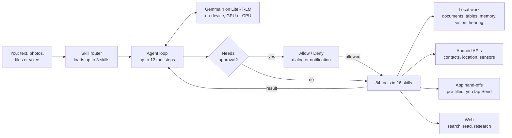

<div align="center">

# MySI

### The AI agent that lives on your phone, not in someone else's cloud.

Tell it, show it or say it. A local model does the thinking on your phone: it reads your documents, sees photos, hears recordings, researches the web and opens your apps with everything ready for your final tap.

[](https://github.com/aryanipb/MySI/actions/workflows/ci.yml)
[](https://github.com/aryanipb/MySI/releases/latest)


</div>

---

## Why MySI

Phone assistants answer questions. MySI **gets things ready**. And unlike cloud agents, its brain runs on the phone, so your messages and contacts are never sent to an LLM provider.

| | |
|---|---|
| 🧠 **On-device inference** | Gemma 4 on Google's LiteRT-LM, GPU first with CPU fallback. No LLM API, no API key, no per-token bill. |
| ⚡ **One-tap setup** | MySI checks your phone's memory and storage, recommends a model that fits, downloads it, verifies its SHA-256 and starts. |
| 👁️ **Sees and hears** | Photos, a live camera view with object detection, and voice recordings are understood on the phone. Nothing is sent to a speech or vision service. |
| 📚 **Real work, locally** | Reads PDF, Word, Excel, PowerPoint and CSV files, searches your own knowledge base, analyses tables, writes documents and remembers what you ask it to. |
| 🌐 **Web research** | Searches, reads pages (including JavaScript-heavy ones), pulls tables and links, downloads files, and writes cited reports whose quotes are checked against the source. |
| 📱 **Hands off to your apps** | Opens WhatsApp, Gmail, Maps, Amazon, Uber and more with everything filled in. You make the final tap. |
| 🛠️ **84 tools in 16 skills** | Only the skills a request needs are loaded, so a small model is never handed 84 tools at once. You can switch any skill off. |
| 🛡️ **You stay in control** | MySI never sends, calls, posts, books or pays by itself, and it only sees files you pick. |

## See what it can do

> "Send the PDF I pick to Riya on WhatsApp."
>
> "Find me a pen on Amazon."
>
> "What's the weather in Pune this weekend?"
>
> "Get me an Uber to the airport."
>
> "Summarise this PDF and list the deadlines in it."
>
> "How many people are in this photo?"
>
> "Research the best budget phones this year and give me a report with sources."

## How it works



Each request loads the always-on core tools plus the few skills that match it; the model can ask for another with `use_skill`. Long jobs such as deep research and transcription run as app-driven pipelines that call the model in small, checked steps. Every tool call goes through MySI's own gate. The engine's automatic tool calling is deliberately off, so the model can only *request* an action and the app decides whether it runs.

## Skills and tools

| Skill | Tools |
|---|---|
| **Core** (always on) | `get_datetime` `open_app` `list_apps` `clipboard_read` `clipboard_write` `pick_files` `list_files` `use_skill` `read_result` |
| **Communication** | `whatsapp_message` `whatsapp_files` `compose_sms` `compose_email` `dial_number` `search_contacts` `share_to_app` |
| **Files** | `take_photo` `read_text_file` `write_text_file` |
| **Documents** | `read_document` `document_info` `search_document` `create_pdf` `create_docx` `create_xlsx` `create_csv` `create_markdown` |
| **Knowledge base** | `kb_add` `kb_list` `kb_remove` `kb_search` |
| **Data analyst** | `table_info` `table_query` `table_stats` `calculate` |
| **Memory** | `remember` `recall` `list_memories` `forget` |
| **Planner** | `add_task` `list_tasks` `complete_task` `add_note` `search_notes` `add_calendar_event` |
| **Vision** | `look_at_image` `detect_objects` `read_text_in_image` |
| **Hearing** | `record_audio` `transcribe_audio` `listen_to_audio` `identify_sounds` |
| **Web** | `search_internet` `search_news` `wikipedia` `read_web_page` `read_rendered_page` `page_links` `page_tables` `find_in_page` `download_file` `weather` `currency_rate` `deep_research` |
| **Browser** | `open_in_chrome` `google_app_search` |
| **Device** | `get_location` `read_sensors` `device_status` `flashlight` `vibrate` `open_settings` |
| **Alarms and media** | `set_alarm` `set_timer` `set_volume` `media_control` `speak` |
| **Social** | `post_to_social` `open_profile` `youtube_search` |
| **Shopping and travel** | `amazon_search` `ride_to` `maps` `play_store_search` |

Vision uses Gemma 4's own image input plus a bundled EfficientDet-Lite0 detector for exact counts. Hearing uses Gemma 4's audio input plus a bundled YAMNet sound classifier. Both bundled models are Apache-2.0 and run through MediaPipe Tasks on the phone; see [third-party notices](THIRD_PARTY_NOTICES.md).

## Safety by design

- **You make the final tap.** Messages, emails, calls, posts, rides and orders open pre-filled in the right app. Nothing is sent, booked or paid without you.
- **No screen control.** MySI does not use Accessibility and cannot read or tap other apps.
- **Senses stay local.** Camera frames and recordings are processed on the phone. The microphone records only while you hold the button or ask MySI to record.
- **Your files, your choice.** MySI only sees files you choose in Android's picker, and the files it makes.
- **Private data stays put.** Once a chat has read your contacts, location, files, apps or clipboard, every web search, page read or link MySI opens needs your approval until you start a new chat. Messages and shares always wait for your own tap.
- **Permissions in context.** Contacts and location are asked for only when a task first needs them.
- **Prompt-injection rule.** Text from web pages, files and contacts is treated as data, never as instructions.
- **Report bad replies.** Every AI reply has a *Report this reply* link that sends it to the MySI team from inside the app.
- **Bounded runs.** Each request is capped at 12 tool steps.

Model inference is fully local. Web search, page reading and reports use the network like any other app. See the [privacy policy](PRIVACY.md).

## Permissions

| Permission | Why |
|---|---|
| Internet, network state | Web search, reading pages, model download, AI content reports |
| Contacts | Turning a name into a number for WhatsApp, and `search_contacts` |
| Location (approximate or precise) | `get_location` |
| Camera | The live camera view. Asked the first time you open it |
| Microphone | Hold-to-talk and `record_audio`. Asked the first time you use it |
| Notifications | Allow/Deny prompts while another app is open |
| Vibrate, set alarm | `vibrate`, `set_alarm`, `set_timer` |

No SMS, call log, Accessibility, notification access, all-files access, system-settings or background-service permissions.

## Quick start

1. Download the latest APK from [**Releases**](https://github.com/aryanipb/MySI/releases/latest). Most phones need the `arm64` build.
2. Open MySI and tap **Get a model**. MySI recommends a Gemma 4 model that fits your phone, downloads it from Google's [LiteRT Community](https://huggingface.co/litert-community) page on Hugging Face, checks its SHA-256 and starts.
3. Already have a `.litertlm` file? Choose **Use a file I already have** and pick it.

Requires Android 14 or later. Gemma 4 E2B is a 2.6 GB download and Google lists 8 GB of RAM as its minimum; E4B is 3.7 GB and needs 12 GB.

## Build from source

Requires JDK 17 and the Android SDK.

```bash
git clone https://github.com/aryanipb/MySI.git
cd MySI
./gradlew assembleRelease
```

Without release-key environment variables, local builds use your debug key. APKs land in `app/build/outputs/apk/release/`; `./gradlew bundleRelease` makes the Play bundle in `app/build/outputs/bundle/release/`.

In-app AI content reports go to a Google Form. Make a form with short or paragraph questions, then use ⋮ → **Get pre-filled link** and type each question's key as its answer: `category`, `reply`, `details`, `prompt`, `model` and `app_version` (`category` and `reply` are required). Put that link in `mysi.reportUrl` in `gradle.properties` (or override it with `MYSI_REPORT_URL`). Builds signed with the release key fail without a valid link. The form must not require sign-in.

## CI/CD

- **CI** runs the unit tests, lints and builds every push and pull request.
- **Release** runs on any `v*` tag, builds signed APKs and the Play `.aab`, and publishes them to GitHub Releases with SHA-256 checksums. It needs the `MYSI_KEYSTORE_BASE64`, `MYSI_KEYSTORE_PASSWORD`, `MYSI_KEY_ALIAS` and `MYSI_KEY_PASSWORD` secrets.

## Project layout

```text
app/src/main/java/com/mysi/agent/
├── Agent.kt, AgentLoop.kt   Model lifecycle, the tool-calling loop and the approval gate
├── Router.kt, Skills.kt     Skill registry and per-request skill routing
├── Pipeline.kt              App-driven multi-step jobs (summarise, map-reduce)
├── Transcript.kt, ResultStore.kt  Context budget and paged tool results
├── Tools.kt, AppTools.kt    Phone tools and hand-offs to other apps
├── skills/                  Documents, knowledge base, data analyst, memory, planner
├── senses/                  Vision, hearing, recorder and the live camera screen
├── web/                     Safe HTTP client, search, page reading, deep research
├── models/                  Model catalogue, recommender, download and setup screen
├── Storage.kt               Workspace, picked files and publishing to Download/MySI
├── Approvals.kt             Allow/Deny notifications while another app is open
├── Reports.kt               In-app reporting of AI replies
├── MainActivity.kt, Composer.kt  Chat, attachments, hold to talk
├── SkillsActivity.kt, MemoryActivity.kt  Skills and Memory screens
└── Ui.kt                    Lightweight view-based UI
```

## Built by

**Aryan Babar** · [@aryanipb](https://github.com/aryanipb)
