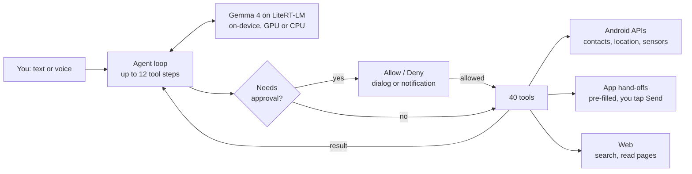

<div align="center">

# MySI

### The AI agent that lives on your phone, not in someone else's cloud.

Tell it what you want. It runs a local model, searches the web, and opens your apps with everything ready for your final tap.

[](https://github.com/aryanipb/MySI/actions/workflows/ci.yml)
[](https://github.com/aryanipb/MySI/releases/latest)


</div>

---

## Why MySI

Phone assistants answer questions. MySI **gets things ready**. And unlike cloud agents, its brain runs on the phone, so your messages and contacts are never sent to an LLM provider.

| | |
|---|---|
| 🧠 **On-device inference** | Gemma 4 on Google's LiteRT-LM, GPU first with CPU fallback. No LLM API, no API key, no per-token bill. |
| 📱 **Hands off to your apps** | Opens WhatsApp, Gmail, Maps, Amazon, Uber and more with everything filled in. You make the final tap. |
| 🛠️ **40 tools** | Messaging, files, camera, sensors, device controls, web search, shopping and rides. |
| 🛡️ **You stay in control** | MySI never sends, calls, posts, books or pays by itself, and it only sees files you pick. |

## See what it can do

> "Send the PDF I pick to Riya on WhatsApp."
>
> "Find me a pen on Amazon."
>
> "What's the weather in Pune this weekend?"
>
> "Get me an Uber to the airport."

## How it works



Every tool call goes through MySI's own gate. The engine's automatic tool calling is deliberately off, so the model can only *request* an action and the app decides whether it runs.

## Tools

| Area | Tools |
|---|---|
| **Communication** | `whatsapp_message` `whatsapp_files` `compose_sms` `compose_email` `dial_number` `search_contacts` |
| **Commerce and travel** | `amazon_search` `ride_to` `maps` |
| **Web and media** | `search_internet` `read_web_page` `open_in_chrome` `google_app_search` `youtube_search` `play_store_search` `media_control` |
| **Files** | `pick_files` `list_files` `read_text_file` `write_text_file` `create_pdf` `share_to_app` |
| **Social** | `post_to_social` `open_profile` |
| **Device** | `open_app` `list_apps` `get_location` `read_sensors` `device_status` `take_photo` `speak` `flashlight` `vibrate` `set_volume` `open_settings` `set_alarm` `set_timer` `clipboard_read` `clipboard_write` `get_datetime` |

## Safety by design

- **You make the final tap.** Messages, emails, calls, posts, rides and orders open pre-filled in the right app. Nothing is sent, booked or paid without you.
- **No screen control.** MySI does not use Accessibility and cannot read or tap other apps.
- **Your files, your choice.** MySI only sees files you choose in Android's picker, and the files it makes.
- **Private data stays put.** Once a chat has read your contacts, location, files, apps or clipboard, every web search, page read or link MySI opens needs your approval until you start a new chat. Messages and shares always wait for your own tap.
- **Permissions in context.** Contacts and location are asked for only when a task first needs them.
- **Prompt-injection rule.** Text from web pages, files and contacts is treated as data, never as instructions.
- **Report bad replies.** Every AI reply has a *Report this reply* link that sends it to the MySI team from inside the app.
- **Bounded runs.** Each request is capped at 12 tool steps.

Model inference is fully local. Web search, page reading and reports use the network like any other app. See the [privacy policy](PRIVACY.md).

## Permissions

| Permission | Why |
|---|---|
| Internet, network state | Web search, reading pages, AI content reports |
| Contacts | Turning a name into a number for WhatsApp, and `search_contacts` |
| Location (approximate or precise) | `get_location` |
| Notifications | Allow/Deny prompts while another app is open |
| Vibrate, set alarm | `vibrate`, `set_alarm`, `set_timer` |

No SMS, call log, Accessibility, notification access, all-files access, system-settings or background-service permissions.

## Quick start

1. Download the latest APK from [**Releases**](https://github.com/aryanipb/MySI/releases/latest). Most phones need the `arm64` build.
2. Download a Gemma 4 `.litertlm` model, for example from [LiteRT Community](https://huggingface.co/litert-community).
3. Open MySI, tap **Load model** and pick the file. MySI copies it into its own storage.

Requires Android 14 or later and enough free RAM and storage for the model you choose.

## Build from source

Requires JDK 17 and the Android SDK.

```bash
git clone https://github.com/aryanipb/MySI.git
cd MySI
./gradlew assembleRelease
```

Without release-key environment variables, local builds use your debug key. APKs land in `app/build/outputs/apk/release/`; `./gradlew bundleRelease` makes the Play bundle in `app/build/outputs/bundle/release/`.

In-app AI content reports go to a Google Form. Make a form with short or paragraph questions, then use ⋮ → **Get pre-filled link** and type each question's key as its answer: `category`, `reply`, `details`, `prompt`, `model` and `app_version` (`category` and `reply` are required). Put that link in `mysi.reportUrl` in `gradle.properties` (or override it with `MYSI_REPORT_URL`). Builds signed with the release key fail without a valid link. The form must not require sign-in.

## CI/CD

- **CI** runs the unit tests, lints and builds every push and pull request.
- **Release** runs on any `v*` tag, builds signed APKs and the Play `.aab`, and publishes them to GitHub Releases with SHA-256 checksums. It needs the `MYSI_KEYSTORE_BASE64`, `MYSI_KEYSTORE_PASSWORD`, `MYSI_KEY_ALIAS` and `MYSI_KEY_PASSWORD` secrets.

## Project layout

```text
app/src/main/java/com/mysi/agent/
├── Agent.kt         Model lifecycle, the tool-calling loop and the approval gate
├── Tools.kt         Core phone tools
├── AppTools.kt      Hand-offs to WhatsApp, email, social, Amazon, Maps and ride apps
├── Web.kt           Background web search and page reading
├── Storage.kt       Workspace, picked files and publishing to Download/MySI
├── Approvals.kt     Allow/Deny notifications while another app is open
├── Reports.kt       In-app reporting of AI replies
├── MainActivity.kt  Chat, pickers, permissions and model loading
└── Ui.kt            Lightweight view-based UI
```

## Built by

**Aryan Babar** · [@aryanipb](https://github.com/aryanipb)
