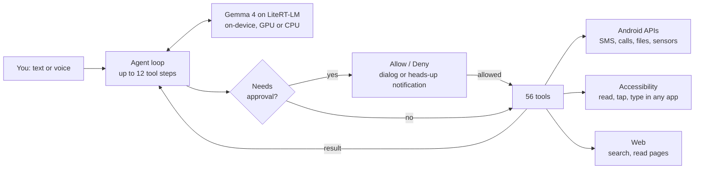

<div align="center">

# MySI

### The AI agent that lives on your phone, not in someone else's cloud.

Tell it what you want. It runs a local model, opens your apps, reads the screen, taps, types and gets it done.

[](https://github.com/aryanipb/MySI/actions/workflows/ci.yml)
[](https://github.com/aryanipb/MySI/releases/latest)


</div>

---

## Why MySI

Phone assistants answer questions. MySI **does the task**. And unlike cloud agents, its brain runs on the phone, so your messages, contacts and screen are never sent to an LLM provider.

| | |
|---|---|
| 🧠 **On-device inference** | Gemma 4 on Google's LiteRT-LM, GPU first with CPU fallback. No LLM API, no API key, no per-token bill. |
| 📱 **Works with any app** | Uses Android Accessibility to read, tap, type and scroll, so it isn't limited to apps with an API. |
| 🛠️ **56 tools** | Messaging, calls, files, camera, sensors, device settings, web search, shopping and rides. |
| 🛡️ **Human in the loop** | Sensitive actions need your approval, and it stops at the payment page. You always pay yourself. |

## See what it can do

> "Send the latest PDF from my Downloads to Riya on WhatsApp."
>
> "Add any pen under ₹500 to my Amazon cart."
>
> "Order a margherita pizza on Zomato and take me to checkout."
>
> "Compare Uber options to the airport."

## How it works



Every tool call goes through MySI's own gate. The engine's automatic tool calling is deliberately off, so the model can only *request* an action and the app decides whether it runs.

## Tools

| Area | Tools |
|---|---|
| **Screen control** | `open_app` `read_screen` `tap_text` `type_text` `scroll` `press_button` |
| **Communication** | `send_whatsapp` `whatsapp_send_files` `send_sms` `read_sms` `send_email` `call_phone` `read_call_log` `search_contacts` `read_notifications` |
| **Commerce** | `amazon_search` `amazon_add_to_cart` `app_search` `add_item` `go_to_checkout` `book_ride` |
| **Web and media** | `search_internet` `read_web_page` `open_in_chrome` `google_app_search` `youtube_search` `maps` `play_store_search` `media_control` |
| **Files** | `find_media` `find_files` `list_files` `read_text_file` `write_text_file` `create_pdf` `share_to_app` |
| **Social** | `post_to_social` `open_profile` |
| **Device** | `get_location` `read_sensors` `device_status` `take_photo` `record_audio` `speak` `flashlight` `vibrate` `set_volume` `set_brightness` `bluetooth` `open_settings` `set_alarm` `set_timer` `clipboard_read` `clipboard_write` `list_apps` `get_datetime` |

Food and grocery skills cover Zomato, Swiggy, Blinkit, BigBasket and Amazon Now. Rides cover Uber, Ola and Rapido.

## Safety by design

An agent with this much access has to be built defensively:

- **Approval gate.** Sensitive tools ask first, even when another app is on screen. No answer within 2 minutes counts as no.
- **No autonomous payments.** MySI goes up to the payment page and stops.
- **Prompt-injection rule.** Text from SMS, notifications, screens, files and contacts is treated as data, never as instructions.
- **Secrets stay put.** The agent is instructed never to share OTPs, passwords or bank details.
- **Bounded runs.** Each request is capped at 12 tool steps.

Model inference is fully local. Tasks that need the internet, such as web search or shopping, still use the network like any other app. The agent's safeguards are a mix of hard app logic and model instructions, so treat MySI as an early release and review what it does.

## Quick start

1. Download the latest APK from [**Releases**](https://github.com/aryanipb/MySI/releases/latest). Most phones need the `arm64` build.
2. Download a Gemma 4 `.litertlm` model, for example from [LiteRT Community](https://huggingface.co/litert-community), and save it to `Download`.
3. Open MySI, tap **Load model**, then **Grant access** and finish the setup list.
4. If Android blocks Accessibility as a restricted setting, go to App info → ⋮ → **Allow restricted settings**.

Requires Android 14 or later and enough free RAM and storage for the model you choose.

## Build from source

Requires JDK 17 and the Android SDK.

```bash
git clone https://github.com/aryanipb/MySI.git
cd MySI
./gradlew assembleRelease
```

Without release-key environment variables, local builds use your debug key. APKs land in `app/build/outputs/apk/release/`.

## CI/CD

- **CI** lints and builds every push and pull request.
- **Release** runs on any `v*` tag, builds signed APKs and publishes them to GitHub Releases with SHA-256 checksums.

## Project layout

```text
app/src/main/java/com/mysi/agent/
├── Agent.kt                      Model lifecycle and the tool-calling loop
├── Tools.kt                      Core phone tools
├── AppTools.kt                   WhatsApp, email, social, web, Amazon and file search
├── ShopTools.kt                  Food, grocery and ride skills
├── AgentAccessibilityService.kt  Reads the screen and performs gestures
├── Approvals.kt                  Heads-up approvals over any app
├── AgentService.kt               Keeps the agent alive in the background
├── NotificationReader.kt         Notification access
├── MainActivity.kt               Chat, setup and model loading
└── Ui.kt                         Lightweight view-based UI
```

## Built by

**Aryan Babar** · [@aryanipb](https://github.com/aryanipb)
